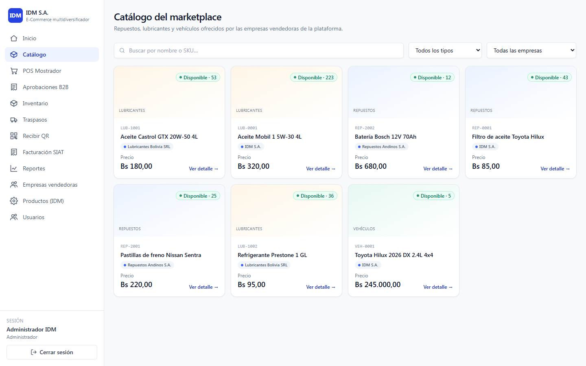
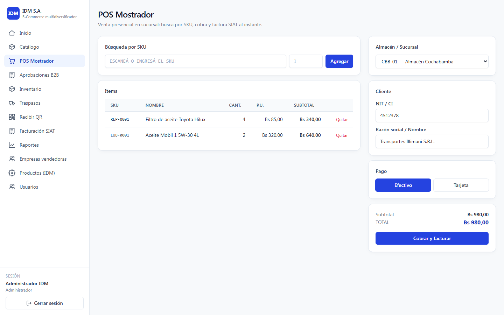
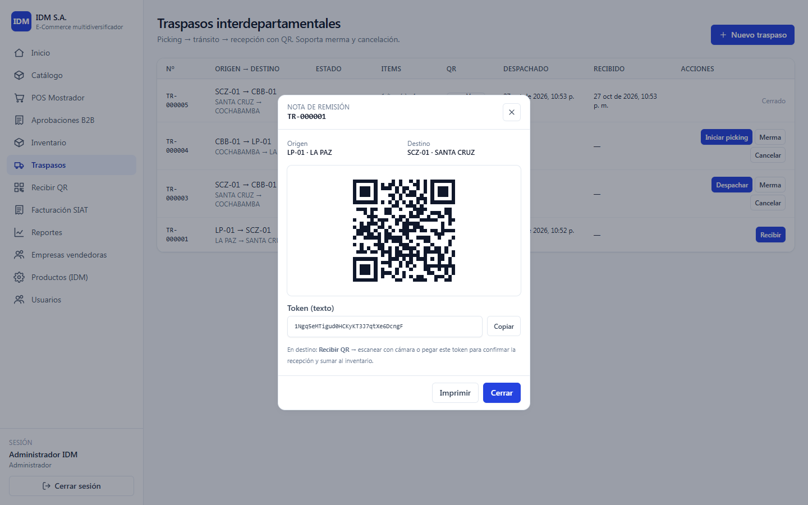
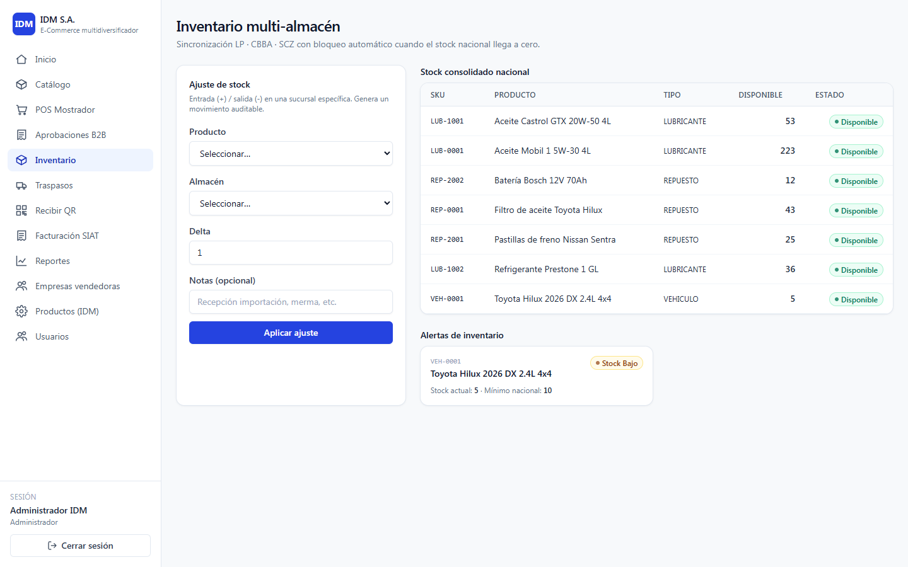
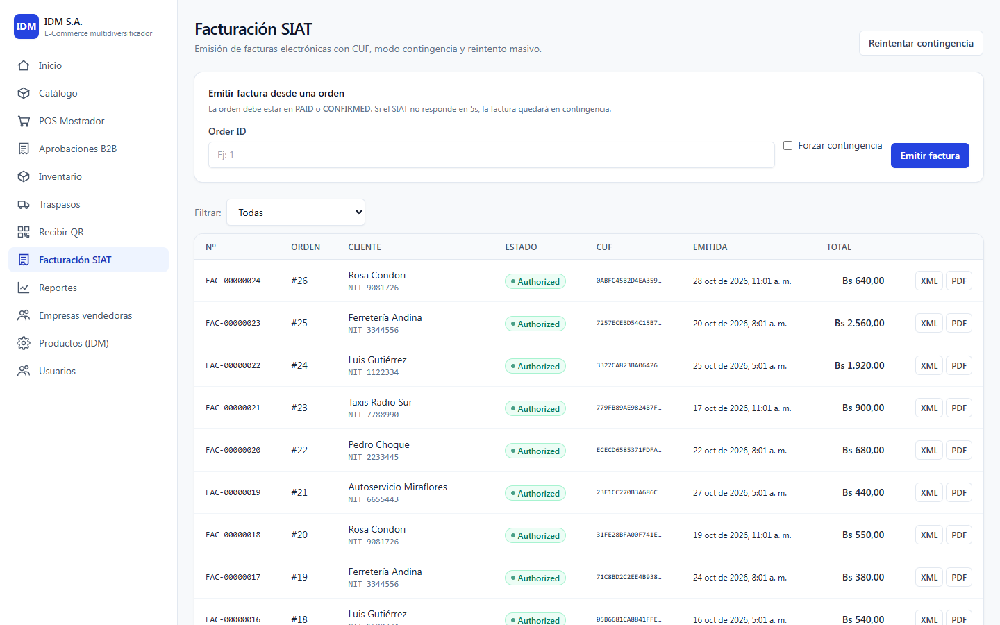
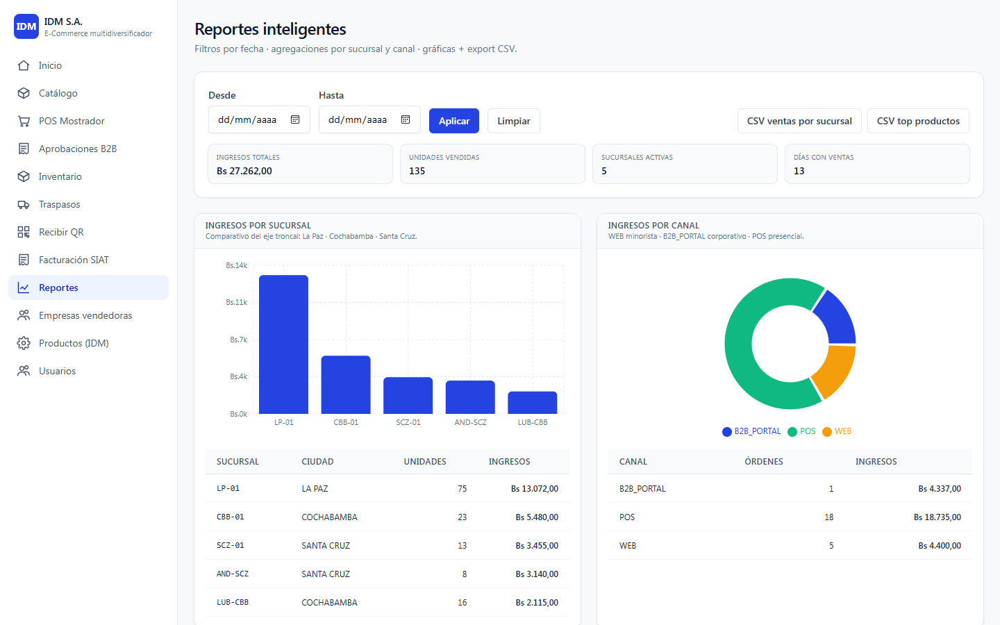
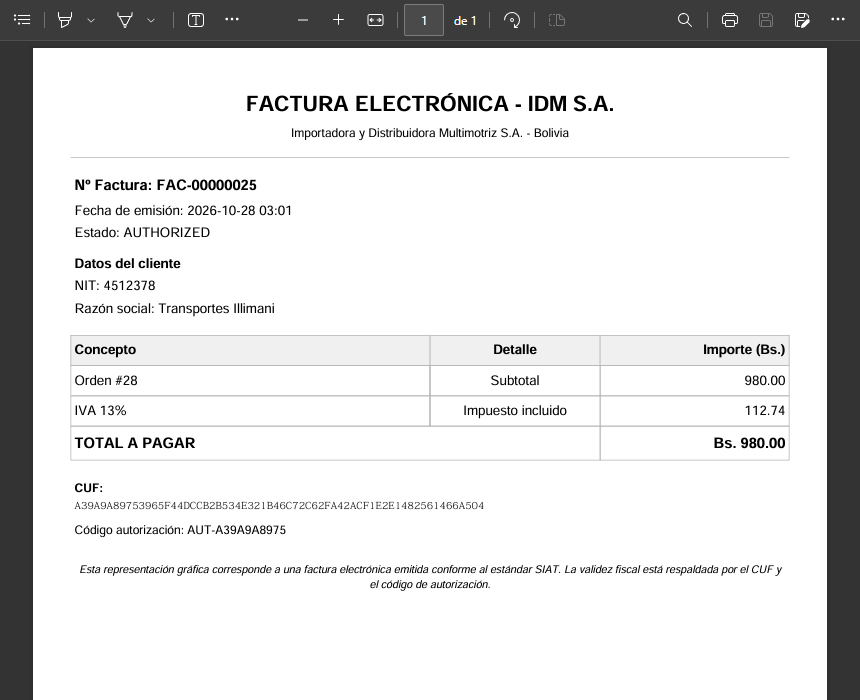

# IDM E-Commerce

Marketplace multi-empresa y ERP liviano para una importadora de repuestos, lubricantes y vehículos en Bolivia. Una sola plataforma cubre la venta minorista en línea (B2C), la venta mayorista a crédito con aprobación (B2B), el punto de venta de mostrador, el inventario de tres sucursales (La Paz, Cochabamba y Santa Cruz) con traspasos verificados por QR y la facturación electrónica con el flujo del **SIAT**, incluido el modo contingencia. Otras empresas pueden registrarse como vendedoras y operar con su propio catálogo, almacenes y ventas.

Backend async con FastAPI + PostgreSQL, frontend React + TypeScript, todo levantado con Docker Compose.



> Proyecto de Taller de Grado (Técnico Superior), UMSA. Caso de estudio: Importadora y Distribuidora Multimotriz S.A. (IDM S.A.).

## Funcionalidades

**Para el cliente minorista (B2C)**

- Catálogo de todas las empresas aprobadas, con búsqueda por nombre o SKU, filtros por tipo y empresa, y stock nacional disponible.
- Carrito que **reserva el stock** durante 15 minutos y elige la sucursal automáticamente (la de su ciudad si tiene stock; si no, la de mayor disponibilidad).
- Checkout con envío por ciudad y pago por pasarela (QR, tarjeta o transferencia; simulada).
- Al pagar se emite la factura electrónica; desde *Mis órdenes* descarga el **PDF** y el **XML**.

**Para el cliente mayorista (B2B)**

- Precio mayorista automático (12 % de descuento) y compra **a crédito** contra su línea de crédito.
- La orden queda en `PENDING_APPROVAL` con el stock reservado hasta que un ejecutivo de ventas la aprueba o la rechaza.
- Si el pedido supera el crédito disponible, el checkout se bloquea sin perder el carrito.

**Para sucursales y almacenes**

- **POS de mostrador:** búsqueda por SKU, NIT/CI del cliente, efectivo o tarjeta. Descuenta el stock de la sucursal y emite la factura en el acto.
- **Inventario multi-almacén:** stock por sucursal y consolidado nacional, ajustes con nota y alertas de stock bajo o agotado.
- **Traspasos entre sucursales:** solicitud → picking → despacho → recepción, con **nota de remisión con código QR**. El almacén de destino la recibe escaneándola con la cámara web o pegando el token. También se puede rechazar por merma o cancelar.

**Para la administración**

- **Facturación SIAT:** listado con estado y CUF, emisión manual, contingencia forzada para pruebas y reintento masivo de facturas pendientes.
- **Reportes:** ingresos por sucursal y por canal (web, B2B, POS), tendencia diaria, top de productos y movimientos de inventario, con filtro de fechas y exportación CSV.
- **Dashboard** con KPIs: ingresos, órdenes B2B pendientes, facturas autorizadas o en contingencia y stock nacional.
- Gestión de usuarios y roles, alta de clientes B2B con línea de crédito, productos y categorías, y aprobación, rechazo o suspensión de empresas vendedoras.

**Para las empresas vendedoras (marketplace)**

- Registro público en `/registro-empresa`; la empresa queda `PENDING` hasta que el administrador la aprueba.
- Panel propio con KPIs, CRUD de sus productos, inventario de sus almacenes, sus ventas, aprobación de sus órdenes B2B y POS restringido a sus almacenes.

| POS de mostrador                                     | Nota de remisión con QR                                         |
| ---------------------------------------------------- | --------------------------------------------------------------- |
|         |  |

| Inventario multi-almacén                                    | Facturación SIAT                                        |
| ----------------------------------------------------------- | ------------------------------------------------------- |
|   |  |

| Reportes                                                   | Factura PDF                                               |
| ---------------------------------------------------------- | --------------------------------------------------------- |
|     |  |

## Stack

| Capa          | Tecnología                                                                                    |
| ------------- | --------------------------------------------------------------------------------------------- |
| Backend       | Python 3.12, FastAPI 0.115, SQLAlchemy 2.0 async + asyncpg, Pydantic v2, Alembic             |
| Seguridad     | JWT (python-jose, HS256), passlib + bcrypt, RBAC por dependencia de FastAPI                   |
| Documentos    | fpdf2 (factura PDF A4), XML de factura generado en el backend                                 |
| Base de datos | PostgreSQL 16                                                                                 |
| Frontend      | React 18, TypeScript (`strict`), Vite, Tailwind CSS 3, React Router 6, axios, Recharts        |
| QR            | `qrcode.react` (nota de remisión) y `@yudiel/react-qr-scanner` (lectura con cámara web)        |
| Entorno       | Docker Compose (PostgreSQL + API con recarga en caliente), Makefile opcional                  |

## Decisiones técnicas

### Cero sobreventa: bloqueo pesimista sobre el stock

Cada fila de `inventory` (producto × almacén) guarda `quantity` (físico) y `reserved` (comprometido en carritos, órdenes B2B pendientes y traspasos). Lo disponible es `quantity − reserved`. Nadie modifica esas columnas directamente: todo pasa por cuatro funciones de `app/services/inventory.py` (`adjust_stock`, `reserve_stock`, `release_reservation` y `consume_reservation`), y todas toman primero la fila con bloqueo pesimista:

```python
stmt = select(Inventory).where(
    Inventory.product_id == product_id,
    Inventory.warehouse_id == warehouse_id,
).with_for_update()          # SELECT … FOR UPDATE
```

Dos compras simultáneas de la última unidad se serializan en PostgreSQL: la segunda ve el stock ya reservado y recibe `409`. Si la fila todavía no existe, se crea, y la restricción `UNIQUE (product_id, warehouse_id)` más un reintento ante `IntegrityError` cubren la carrera de dos inserciones a la vez.

Cada mutación deja además un registro en `inventory_movements` (`IN`, `OUT`, `ADJUSTMENT`, `RESERVATION`, `RELEASE`, `TRANSFER_OUT` o `TRANSFER_IN`) con usuario, referencia (orden, carrito o traspaso) y nota. Es el kardex que alimenta el reporte de movimientos.

### Reservar primero, consumir después

El stock se compromete en dos pasos, así ninguna venta a medio camino lo descuenta de verdad:

| Momento                         | Efecto en inventario                                       |
| ------------------------------- | ---------------------------------------------------------- |
| Agregar al carrito              | `reserve_stock` (TTL de 15 min, se renueva con cada ítem)   |
| Checkout B2C pagado             | `consume_reservation`: sale del físico y de la reserva     |
| Checkout B2B a crédito          | Orden `PENDING_APPROVAL`; la reserva **sigue viva**        |
| Aprobación B2B                  | `consume_reservation` + suma a `CreditLine.balance`        |
| Rechazo B2B / pago rechazado    | `release_reservation`                                      |
| Carrito vencido                 | Se libera al volver a usarlo o con `POST /cart/cleanup-expired` |

El crédito se valida dos veces, al hacer el pedido y al aprobarlo, porque entre ambos momentos pudo aprobarse otra orden del mismo cliente. Si no alcanza en el checkout, la reserva se mantiene para que el cliente reduzca el pedido sin perder su carrito.

### Facturación SIAT con modo contingencia

`app/services/siat.py` arma el XML de la factura (cabecera, NIT, razón social, detalle, IVA) y lo envía al SIAT con un timeout de **5 segundos** (`asyncio.wait_for`):

1. La factura se **persiste antes del envío** en estado `PENDING` junto con su XML, así nunca se pierde aunque el envío falle.
2. Si el SIAT responde, pasa a `AUTHORIZED` con su **CUF**, CDC y código de autorización.
3. Si hay timeout, queda `PENDING` marcada como contingencia. `POST /invoices/contingency/retry` (botón *Reintentar contingencia*) reenvía en lotes de 50 las pendientes sin CUF.

La emisión es **idempotente** por orden y ocurre **después del commit de la venta**: en POS, checkout B2C y aprobación B2B, un error del SIAT nunca revierte una venta ya cobrada. El PDF A4 (fpdf2) y el XML solo los descarga el personal autorizado o el cliente dueño de la orden.

> El cliente SIAT y la firma son **simulados**: la respuesta y el CUF se generan localmente y la firma es un hash SHA-256 de marcador. La configuración para el servicio real (`SIAT_BASE_URL`, `SIAT_NIT`, `SIAT_API_KEY`) ya está prevista en `app/core/config.py`. `POST /invoices` acepta `force_fail=true` para simular la caída del SIAT.

### Traspasos como máquina de estados

```
REQUESTED ──► PICKING ──► IN_TRANSIT ──► RECEIVED
    │            │
    └────────────┴──► REJECTED_MERMA | CANCELLED
```

Cada transición de `app/services/transfer.py` valida el estado actual y mueve el inventario en consecuencia:

- **Crear:** reserva el stock en el almacén de origen (no se puede prometer mercadería ya comprometida).
- **Despachar:** consume la reserva en origen (`TRANSFER_OUT`). Se acepta desde `PICKING` o directamente desde `REQUESTED`.
- **Recibir:** suma en destino (`TRANSFER_IN`). Se identifica por ID o por el `qr_token` de la nota de remisión (`secrets.token_urlsafe(24)`), que el destino escanea con la cámara.
- **Merma:** libera la reserva y da de baja la mercadería dañada del origen, con el motivo en la nota.
- **Cancelar:** solo libera la reserva.

Una vez despachado, un traspaso ya no se puede cancelar ni rechazar.

### RBAC y aislamiento multi-empresa

Seis roles (`ADMIN`, `SALES`, `WAREHOUSE_MANAGER`, `SELLER`, `CLIENT_B2B` y `CLIENT_B2C`). Cada endpoint declara quién puede llamarlo con una dependencia de FastAPI:

```python
user: User = Depends(require_roles(UserRole.SALES, UserRole.ADMIN, UserRole.SELLER))
```

El frontend replica las mismas reglas con `ProtectedRoute` y `RoleGuard`, pero la autoridad es siempre el backend. Para las empresas vendedoras hay controles adicionales:

- `get_active_seller` solo deja operar a empresas en estado `APPROVED`.
- Un `SELLER` solo ve y aprueba **sus** órdenes B2B, ajusta **su** inventario y usa el POS en **sus** almacenes.
- El POS rechaza SKUs de otra empresa distinta de la dueña del almacén.
- El carrito es **de una sola empresa** por pedido, porque cada orden pertenece a un único vendedor.
- El catálogo público solo muestra productos de empresas aprobadas.

### Dinero y precios

- Montos en `Decimal` y columnas `NUMERIC(12,2)` / `NUMERIC(14,2)`; nunca `float` en los cálculos.
- El precio incluye el IVA boliviano del 13 %, que se desglosa como `subtotal × 0,13 / 1,13`.
- El precio unitario (con el 12 % mayorista para B2B) se **congela** en el ítem del carrito y luego en la orden: si cambia el precio de lista, el historial no se altera.
- Envío con tarifa fija por ciudad: La Paz Bs 25, Cochabamba Bs 40, Santa Cruz Bs 55.

### Otros detalles

- Backend async de punta a punta: asyncpg, `AsyncSession` con `expire_on_commit=False` y pool con `pool_pre_ping`.
- Esquema versionado con Alembic (3 migraciones) y seed **idempotente**: se puede volver a correr sin duplicar datos.
- `GET /api/v1/health/db` verifica la conexión a la base de datos, además del `/health` básico.
- `bcrypt` fijado en 4.1.3: bcrypt 5.x rompe passlib 1.7.4.
- 75 endpoints REST documentados automáticamente en Swagger (`/docs`).

## Puesta en marcha

Requisitos: **Docker Desktop** y **Node.js 20.19+ o 22.12+** (lo exige Vite). No hace falta instalar Python ni PostgreSQL: el backend y la base de datos corren en contenedores.

```bash
git clone https://github.com/nnvaldev/IDM-Ecommerce-System.git
cd IDM-Ecommerce-System

# PostgreSQL + API
docker compose up --build -d
docker compose exec backend alembic upgrade head
docker compose exec backend python -m app.seed

# Frontend (en otra terminal)
cd frontend
npm install --legacy-peer-deps
npm run dev
```

| Servicio      | URL                          |
| ------------- | ---------------------------- |
| Frontend      | http://localhost:5173        |
| API           | http://localhost:8000        |
| Swagger       | http://localhost:8000/docs   |
| PostgreSQL    | `localhost:5433` (usuario `idm`, base `idm_ecommerce`) |

El proxy de Vite reenvía `/api` a `http://localhost:8000`, así que en desarrollo no hay problemas de CORS. `--legacy-peer-deps` es necesario porque `@vitejs/plugin-react` 4 todavía no declara compatibilidad con Vite 8.

### Windows (PowerShell, sin make)

`make` es solo un atajo para comandos `docker compose`; en Windows no hace falta instalarlo. Con Docker Desktop en estado *Running*, abre PowerShell en la raíz del repo:

```powershell
# Desde cero (borra los datos previos)
docker compose down -v
docker compose up --build -d
docker compose exec backend alembic upgrade head
docker compose exec backend python -m app.seed

# Frontend, en otra ventana de PowerShell
cd frontend
npm install --legacy-peer-deps
npm run dev
```

Equivalencias de `make` en PowerShell:

| `make`         | Comando en Windows                                    |
| -------------- | ----------------------------------------------------- |
| `make up`      | `docker compose up` (agrega `-d` para segundo plano)  |
| `make build`   | `docker compose up --build`                           |
| `make down`    | `docker compose down` (conserva los datos)            |
| `make logs`    | `docker compose logs -f backend`                      |
| `make shell`   | `docker compose exec backend bash`                    |
| `make migrate` | `docker compose exec backend alembic upgrade head`    |
| `make seed`    | `docker compose exec backend python -m app.seed`      |
| `make reset`   | `docker compose down -v; docker compose up --build -d; docker compose exec backend alembic upgrade head; docker compose exec backend python -m app.seed` |

> En PowerShell los comandos se encadenan con `;`. Si prefieres que se detenga ante un error, corre las líneas de a una.

### Problemas comunes

- **`ModuleNotFoundError: No module named 'app'` al cargar el seed:** el seed se ejecuta como módulo (`python -m app.seed`), no como archivo (`python app/seed.py`). Los objetivos `make seed` y `make reset` todavía usan la segunda forma; en ese caso corre el comando de la tabla.
- **`npm install` falla con `ERESOLVE`:** usa `npm install --legacy-peer-deps` (ver arriba).
- **Puerto 5433, 8000 o 5173 ocupado:** cambia el mapeo en `docker-compose.yml` o levanta Vite en otro puerto con `npx vite --port 5180`.
- **"Cannot connect to the Docker daemon":** abre Docker Desktop y espera a que diga *Running*.
- **El frontend carga pero no inicia sesión:** revisa que la API esté arriba con `docker compose logs -f backend`.

### Cuentas de demo

Creadas por `python -m app.seed`:

| Rol         | Email             | Contraseña  | Notas                                                    |
| ----------- | ----------------- | ----------- | -------------------------------------------------------- |
| ADMIN       | `admin@idm.bo`    | `admin123`  | Acceso total. Dueño de la empresa raíz IDM S.A.          |
| CLIENT_B2B  | `taller@demo.bo`  | `demo1234`  | "Taller Mecánico Demo S.R.L.", línea de crédito Bs 10.000 |
| SELLER      | `seller1@demo.bo` | `seller123` | Lubricantes Bolivia SRL (Cochabamba, aprobada)           |
| SELLER      | `seller2@demo.bo` | `seller123` | Repuestos Andinos S.A. (Santa Cruz, aprobada)            |
| CLIENT_B2C  | regístrate tú     | —           | `/register` en la UI o `POST /api/v1/auth/register`      |
| SELLER nueva | regístrate tú    | —           | `/registro-empresa` o `POST /api/v1/sellers/register` (queda `PENDING`) |

El seed también crea tres empresas (IDM S.A. es la raíz, `id = 1`), los almacenes de IDM LP-01, CBB-01 y SCZ-01, un almacén por cada empresa adicional, categorías y productos de cada tipo (repuesto, lubricante y vehículo) con stock repartido y `min_stock = 5`.

### Recorrido sugerido

1. **B2C:** regístrate, agrega productos al carrito y paga. La factura aparece en *Mis órdenes* con PDF y XML.
2. **B2B:** entra como `taller@demo.bo`, compra a crédito y luego, como admin, apruébala en `/aprobaciones`. Un pedido de más de Bs 10.000 queda bloqueado por crédito.
3. **POS:** en `/pos` elige sucursal, agrega SKUs (`REP-0001`, `LUB-0001`), ingresa NIT y cobra; obtienes el número de factura y el CUF.
4. **Traspasos:** en `/traspasos` crea uno de La Paz a Cochabamba, inicia picking y despacha. Con **Ver QR** abres la nota de remisión, y en `/recibir` la escaneas o pegas el token.
5. **Reportes:** `/reportes` con y sin filtro de fechas; exporta a CSV.

## Roles y pantallas

| Ruta                                        | Roles                                    | Pantalla                                   |
| ------------------------------------------- | ---------------------------------------- | ------------------------------------------ |
| `/login`, `/register`, `/registro-empresa`  | público                                  | Acceso y registro de empresa vendedora     |
| `/`                                         | todos                                    | Dashboard                                  |
| `/catalogo`, `/catalogo/:id`                | todos                                    | Catálogo y detalle de producto             |
| `/carrito`, `/mis-ordenes`                  | CLIENT_B2C, CLIENT_B2B                   | Carrito, checkout e historial con facturas |
| `/pos`                                      | ADMIN, SALES, WAREHOUSE_MANAGER, SELLER  | POS de mostrador                           |
| `/aprobaciones`                             | ADMIN, SALES, SELLER                     | Aprobación de órdenes B2B                  |
| `/inventario`                               | ADMIN, WAREHOUSE_MANAGER, SELLER         | Stock, ajustes y alertas                   |
| `/traspasos`, `/recibir`                    | ADMIN, WAREHOUSE_MANAGER                 | Traspasos, nota QR y recepción por cámara  |
| `/facturas`                                 | ADMIN, SALES, WAREHOUSE_MANAGER          | Facturación SIAT                           |
| `/reportes`                                 | ADMIN, SALES                             | Reportes, gráficas y CSV                   |
| `/usuarios`, `/admin/productos`, `/admin/empresas` | ADMIN                             | Usuarios, productos y empresas vendedoras  |
| `/empresa`, `/empresa/productos`, `/empresa/ventas` | SELLER                           | Panel de la empresa vendedora              |

## Estructura

```
backend/
├── app/
│   ├── api/v1/          auth, catalog, cart, b2b, pos, inventory, transfers,
│   │                    invoices, reports, sellers, users, warehouses, health
│   ├── core/            config, base de datos async, JWT, dependencias RBAC (deps.py)
│   ├── models/          Seller, User, Customer/CreditLine, Product, Warehouse,
│   │                    Inventory/InventoryMovement, Cart, Order, Payment,
│   │                    StockTransfer, Invoice
│   ├── schemas/         Pydantic de entrada y salida por dominio
│   ├── services/
│   │   ├── inventory.py         reservas y movimientos con SELECT … FOR UPDATE
│   │   ├── cart.py              carrito, checkout B2C/B2B, aprobación de crédito
│   │   ├── transfer.py          máquina de estados de traspasos
│   │   ├── siat.py              XML, envío con timeout, contingencia y PDF
│   │   ├── pricing.py           precio mayorista y tarifas de envío
│   │   ├── payment_gateway.py   pasarela simulada
│   │   └── reports.py           agregaciones para dashboard y reportes
│   └── seed.py          datos de demo idempotentes
├── alembic/versions/    migraciones
└── Dockerfile
frontend/src/
├── pages/               21 pantallas (Catalog, Cart, POS, Transfers, ScanReceive,
│                        Invoices, Reports, SellerDashboard, …)
├── components/          Layout, KpiCard, Charts (Recharts), RoleGuard, ProtectedRoute, …
├── contexts/            AuthContext, ToastContext
└── lib/                 api.ts (axios + JWT), format.ts, types.ts
docker-compose.yml       PostgreSQL 16 + API
Makefile                 atajos opcionales
```

## Próximos pasos

- [ ] Integración real con el SIAT (credenciales, firma digital con certificado y CUF oficial); hoy el cliente es simulado.
- [ ] Pasarela de pagos real (QR / tarjeta) detrás de la misma interfaz `charge()`.
- [ ] Liberar los carritos vencidos con una tarea programada en lugar del endpoint manual.
- [ ] Tests automatizados de los flujos de concurrencia, crédito B2B y traspasos, y CI con GitHub Actions.
- [ ] Notificaciones (email) para órdenes B2B pendientes y mermas.

Fuera de alcance del Taller: agendamiento de talleres, contabilidad, apps móviles nativas y tracking GPS de última milla.

---

Desarrollado por **Alexander Castillo** ([@nnvaldev](https://github.com/nnvaldev)) · La Paz, Bolivia.
